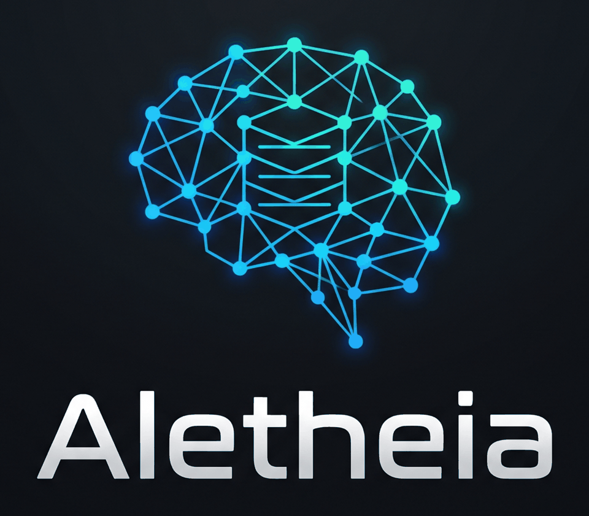

> Machine-translated from the English README on 2026-10-26. Review welcome: open a pull request against this file.
> Source: [README.md](../../README.md) · source-sha256: 8c4bc2ea47cc43155483cc685a4fb5c690a01b01927ab32acbb65d0e43a581e4

[English](../../README.md) · [中文](README.zh.md) · [Español](README.es.md) · [Português (Brasil)](README.pt-br.md) · [日本語](README.ja.md) · [Deutsch](README.de.md) · [Français](README.fr.md) · [한국어](README.ko.md) · [हिन्दी](README.hi.md) · [العربية](README.ar.md) · [Русский](README.ru.md)

<p align="center"></p>

# Aletheia

**Un centro gratuito y local de memoria y reglas para herramientas de programación con IA.**

[](../../LICENSE)
[](https://github.com/mohamed-ashraf-elsaed/aletheia-mem/actions/workflows/test.yml)
[](https://github.com/mohamed-ashraf-elsaed/aletheia-mem/commits/main)
[](https://github.com/mohamed-ashraf-elsaed/aletheia-mem/stargazers)
[](https://github.com/mohamed-ashraf-elsaed/aletheia-mem/issues)


**Estado: alfa.** El motor de memoria y los instaladores funcionan en las pruebas. Los Claude Code, Command Code, Codex CLI y OpenCode reales listaron la configuración MCP generada. Los hooks se han ejecutado en sesiones reales de Claude Code (dos días de uso), Command Code (una sesión corta) y Codex CLI (una sesión interactiva), todo en la máquina del autor y con un solo usuario, con secretos redactados y sin fugas detectadas por el comprobador. Aún no se ha ejecutado ningún hook dentro de Cursor, Gemini CLI, Windsurf u OpenCode, y la precisión de las respuestas no está medida. La CI ejecuta el conjunto de pruebas en Linux, macOS y Windows. En Windows se omiten dos comprobaciones de hooks (Windsurf y Gemini CLI) y no se probó ninguna herramienta real, así que Windows solo está probado en la CI.

Las traducciones automáticas están en `docs/i18n/`; la versión inglesa es la canónica. Ninguna traducción ha sido revisada por un hablante nativo.

## Qué es

Aletheia es un centro gratuito y local de memoria y reglas para herramientas de programación con IA. Cualquier herramienta lee el mismo almacén SQLite por MCP, REST o la CLI, y tus reglas se escriben en el archivo de instrucciones propio de cada herramienta.

Cada agente de programación olvida entre sesiones, y cada uno recuerda de forma distinta. Aletheia guarda la memoria y las reglas una sola vez, en tu máquina, y deja que cada herramienta las lea en el formato que ya entiende. No hay cuenta, ni telemetría, ni llamada de red salvo que configures un proveedor de modelos. Solo escucha en loopback.

## Instalación en tres comandos

```bash
git clone https://github.com/mohamed-ashraf-elsaed/aletheia-mem
cd aletheia-mem
bun bin/aletheia-server.mjs
```

Abre <http://127.0.0.1:37790>. Necesita [Bun](https://bun.sh) 1.1 o posterior. No hay paso `npm install` porque no hay dependencias de ejecución.

La primera pantalla tiene cinco pestañas: **Home** (empieza aquí: elige un proyecto y mira, en palabras sencillas, qué sabe Aletheia de él, sus reglas y las herramientas conectadas), **Activity** (la vista propia de Aletheia de las solicitudes y sesiones en las que trabajaron tus herramientas), **Knowledge** (buscar, editar, fijar, ocultar, exportar), **Rules** (escribir una vez y sincronizar) y **Connections** (estado de los instaladores y auditoría).

## Cómo funciona la captura

```bash
aletheia install claude-code --write
aletheia install cursor --write
aletheia install --list          # capability level and verification per tool
```

Sin `--write` el comando es una simulación. Imprime cada archivo que cambiaría y no escribe nada. Cada archivo modificado recibe una copia de seguridad con marca de tiempo. Los hooks llaman al comando `aletheia` instalado, redactan secretos y bloques `<private>` antes de guardar, escriben en disco si la base de datos no está disponible y siempre salen con 0 para no bloquear al anfitrión. La compresión se encola, no se ejecuta dentro del hook. Detalles y la lista exacta de hooks por anfitrión: [docs/25](../../docs/25-installers.md).

## Con qué herramientas se conecta

Aletheia no depende de una sola herramienta. Habla MCP (stdio y HTTP), una API REST simple y una CLI, y escribe el archivo de instrucciones que cada herramienta ya lee. Lo que se ha comprobado y lo que no:

| Check | Result |
|---|---|
| MCP server against the official MCP SDK client | Passes (protocol versions 2025-11-25 to 2024-11-05) |
| Config formats for Claude Code, Command Code, Cursor, Codex CLI, Gemini CLI, Windsurf, OpenCode | Written from official docs fetched 2026-10-26 and tested against fixtures. **Not tested on a real install.** |
| Claude Desktop MCP config | Documented and merge-tested against a fixture; not opened in the app |
| Rules files: `CLAUDE.md`, `AGENTS.md`, `GEMINI.md`, `.cursor/rules/*.mdc`, `.windsurf/rules/*.md`, Copilot, Aider | Written and tested in temp folders (`docs/verification/rules-targets.md`) |
| Any of the above **on a real install of that tool** | **Not tested yet.** Reports welcome. |
| Automatic capture through a tool's hooks | Built for Claude Code, Command Code, Cursor, Codex CLI, Gemini CLI and Windsurf. Each installed hook command is exercised end to end in a temp HOME with a recorded payload; none has been run inside the tool. OpenCode is MCP+rules. |

<!-- gen:tools -->
| Tool | Level | Verification | Hook events installed |
|---|---|---|---|
| claude-code | full | MCP connection 2.1.312 on 2026-10-27; hooks ran in real sessions over two days of use; one user on one machine | SessionStart, UserPromptSubmit, PostToolUse, Stop, SessionEnd |
| command-code | full | MCP connection 1.88.1 on 2026-10-27; hooks ran in one short session; one user on one machine | SessionStart, PostToolUse, Stop |
| cursor | full | config written from docs, not tested on a real install | sessionStart, beforeSubmitPrompt, postToolUse, afterAgentResponse, stop, sessionEnd |
| codex | full | MCP connection 0.130.0 on 2026-10-27; hooks ran in one interactive session (reviewed once with /hooks); one user on one machine | SessionStart, UserPromptSubmit, PostToolUse, Stop, SessionEnd |
| gemini-cli | full | config written from docs, not tested on a real install | SessionStart, BeforeAgent, AfterTool, AfterAgent, SessionEnd |
| windsurf | full | config written from docs, not tested on a real install | pre_user_prompt, post_run_command, post_write_code, post_cascade_response |
| opencode | mcp+rules | MCP connection 1.18.33 on 2026-10-27; hooks not run | none (MCP and rules only) |

_Generated from src/hub/install.mjs via `aletheia install --list`. A row says MCP connection when the real CLI listed the server. Hooks have run in real sessions of Claude Code (two days of use), Command Code (one short session) and Codex CLI (one interactive session), one user on one machine; Cursor, Gemini CLI, Windsurf and OpenCode hooks have not run._
<!-- /gen:tools -->

## Números medidos

En LoCoMo, claude-mem 15.2.0 tal como se distribuye frente a este proyecto. **Son números de recuperación, no precisión de respuestas.**

<!-- gen:bench -->
| Run | Questions | Recall@5 | MRR | ms/query |
|---|---|---|---|---|
| claude-mem 15.2.0 (as shipped), raw turns — measured-by-us | 1,536 | 36.0% | 0.285 | p50 1,699 ms, p95 2,824 ms (idle, 40 queries) |
| Raw turns, all 10 conversations | 1,536 | 57.4% | 0.497 | 3.72 |
| Dataset facts, all 10 | 1,536 | 64.8% | 0.591 | 5.53 |
| Dataset facts, 3 conversations | 383 | 67.4% | 0.620 | 5.80 |
| Dataset facts, 3 conversations, + rerank | 383 | 73.9% | 0.686 | 251.16 |
| Dataset facts, all 10, + rerank | 1,536 | 72.3% | 0.680 | 646.19 |
| Our rule-extracted facts, all 10 | 1,536 | 57.7% | 0.492 | 4.94 |

_Retrieval only: Recall@5 asks whether the gold evidence is in the top five results. It is not answer accuracy. Every row is measured-by-us on the same LoCoMo questions; no vendor-claimed benchmark number is in this table. Generated from bench/results/2026-10-26/ (bench/claude-mem-baseline.mjs, raw-turns.json (hybrid), dataset-facts.json (hybrid+facts), dataset-facts-3-rerank.json (hybrid+facts), dataset-facts-3-rerank.json (hybrid+facts+rerank), dataset-facts-rerank.json (hybrid+facts+rerank), our-facts-rules.json (hybrid+facts)); re-run with `bun scripts/compare-bench.mjs`._
<!-- /gen:bench -->

Lee la tabla así:

- **Recall@5 es recuperación.** Pregunta si la evidencia correcta está entre los cinco primeros resultados. No juzga si una respuesta era correcta.
- **La precisión de respuestas no está medida.** Todavía no hay un banco de lectura ni de evaluación.
- **La diferencia no es 2×** cuando ambos sistemas reciben los mismos hechos extraídos. La diferencia de velocidad es mayor que la de calidad.
- **La primera ejecución de extracción local falló.** Ollama `llama3.2:1b` respondió a una llamada trivial, pero el prompt `facts-v1` sobre una ventana de dos turnos devolvió HTTP 500 tras 4 min 41 s. No se extrajo ningún hecho de esa ejecución.
- **Nuestro extractor de reglas no reproduce la ganancia de los hechos.** Añadió 1.672 hechos y movió Recall@5 de 57,3% a 57,7%; los hechos del propio conjunto añadieron 7,3 puntos. Método, archivos crudos y el resultado negativo: [bench/results](../../bench/results/).

## Cómo se compara

<!-- gen:capabilities -->
| Capability | Aletheia (today) | claude-mem | Mem0 | Zep/Graphiti | Supermemory | Basic Memory |
|---|---|---|---|---|---|---|
| Local-first | yes | yes | yes OSS | partial (Graphiti only) | yes self-host | yes |
| Free | yes | yes OSS | yes OSS | partial (Graphiti free) | yes OSS | yes OSS |
| No account | yes | yes local | yes OSS | yes Graphiti | yes self-host | yes |
| MCP | yes stdio + HTTP | yes | yes | partial (reference servers) | yes | yes |
| REST | yes `/v1` | yes worker API | yes | yes | yes | partial |
| CLI | yes | yes `npx` | partial | no | partial | yes |
| Rules sync to tool files | yes 9 targets | no | no | no | no | partial (AGENTS.md) |
| Import/export between tools | partial (own bundle + claude-mem) | partial (export/import) | partial (platform migration) | partial | partial | yes Markdown |
| Hook capture | yes six hosts, fixture-tested; no host opened | yes | no | no | no | partial |
| Vector search | partial (optional ONNX) | yes Chroma | yes | yes | yes | yes |
| Graph / entity memory | partial (entity rows exist; graph retrieval) | no | yes | yes | UNVERIFIED | yes wikilinks |
| Temporal reasoning | partial (bi-temporal facts, invalidation; as-of query) | partial (dates) | yes | yes | yes | partial |
| Team sharing | partial (self-hosted sync and devices; team mode) | partial (paid) | yes paid | yes paid | yes paid | no |
| Benchmark published and reproducible | partial (retrieval yes; answer no) | no | vendor only | vendor only | vendor only | no |
| Languages supported | 11 (English + 10 machine translations; no native review) | 29 modes, 32 READMEs | SDK | SDK | SDK | SDK |

_Competitor cells are copied from each project's own public documentation, fetched 2026-10-26. Aletheia cells were updated 2026-10-26 from tested features; installer sources are in `docs/25-installers.md`. Cells the source did not state read UNVERIFIED._
<!-- /gen:capabilities -->

## Sincronización y MCP remoto

Ambos son autoalojados y gratuitos; ninguno está probado entre dos máquinas reales.

- **Aletheia Sync** es un registro de operaciones de solo anexión con un resultado por operación, emparejamiento de dispositivos, lápidas, compactación, purga y tokens con alcance. El cifrado de extremo a extremo opcional cifra las cargas en el dispositivo antes de enviarlas; **no oculta metadatos** como el id del dispositivo, el tipo de operación, el id de entidad, el momento o el tamaño del cifrado. Las cuentas no cifradas mantienen las cargas en claro en el concentrador. Probado solo en loopback. [docs/29](../../docs/29-sync.md)
- **MCP remoto** sirve las herramientas de lectura (y, con un token `sync` o `admin`, las de escritura) por el transporte MCP Streamable HTTP. Cada llamada necesita un token de portador, tiene límite de tasa y se escribe en una fila de auditoría de solo anexión. TLS se delega a un proxy inverso o túnel; OAuth no está construido. [docs/30](../../docs/30-remote-mcp.md)

## Interfaces

| Interface | Where | Use |
|---|---|---|
| MCP (stdio) | `bun bin/mcp.mjs` | the 13 MCP tools below (read and write) |
| MCP (HTTP) | sync hub `/mcp` | the same tools with a bearer token and per-token scope |
| REST | `/v1/memories`, `/v1/search`, `/v1/timeline`, `/v1/observations/batch`, `/v1/context`, `/v1/events`, `/v1/info`, `/v1/work` | scripts, CI, any language; optional `ALETHEIA_API_KEY` bearer key |
| CLI | `bin/aletheia.mjs` | hooks, shell, cron, sync |
| Files | rules sync | each tool's own instruction file |

### MCP tools

| Tool | Purpose | Access |
|---|---|---|
| `search` | Search shared memory | read |
| `timeline` | Show context around a memory | read |
| `get_observations` | Get full memory text by id | read |
| `save_memory` | Save a memory | write |
| `session_start_context` | Load session start context | read |
| `fact_history` | Show how a fact changed | read |
| `list_rules` | List standing rules | read |
| `add_rule` | Add a standing rule | write |
| `confirm_rule` | Confirm a rule is still right | write |
| `dismiss_memory` | Dismiss a memory | write |
| `restore_memory` | Restore a dismissed memory | write |
| `work_state_write` | Write a work-state list | write |
| `work_state_read` | Read a work-state list | read |

## Configuración

Todos los ajustes son variables de entorno. Los valores por defecto son seguros para una máquina de un solo usuario.

| Variable | Default | Meaning |
|---|---|---|
| `ALETHEIA_PORT` | `37790` | Listen port. |
| `ALETHEIA_HOST` | `127.0.0.1` | Bind address. A non-loopback bind turns on Hub login. |
| `ALETHEIA_DATA_DIR` | `~/.aletheia` | Everything this project writes, including `hub.db`. |
| `ALETHEIA_HUB_DB` | `<data dir>/hub.db` | The shared memory store. |
| `ALETHEIA_API_KEY` | empty | Bearer key required on `/v1/*` when set. |
| `CLAUDE_MEM_DB` | `~/.claude-mem/claude-mem.db` | claude-mem's database (read-only; importer and optional legacy viewer). |
| `ALETHEIA_RULES_FILE` | `<data dir>/MY-RULES.md` | The legacy Work view's rules file. |
| `ALETHEIA_PROVIDER` | `none` | `none`, `claude-cli` or an OpenAI-compatible provider. |
| `ALETHEIA_PROVIDERS` | empty | Ordered fallback chain, for example `ollama,openai`. |
| `ALETHEIA_OPENAI_BASE_URL`, `_API_KEY`, `_MODEL` | OpenRouter URL, empty, empty | For `openai` and human copy. |
| `ALETHEIA_OUTPUT_LANGUAGE` | empty | Language for extracted facts and summaries. |
| `ALETHEIA_BUG_COMPAT` | off | `1` reproduces the original's empty observation half. |
| `ALETHEIA_TOOL`, `ALETHEIA_CWD` | | MCP server: names the calling tool and default project. |

## Límites y afirmaciones no verificadas

Esta lista es la mitad honesta del README.

- Ninguna configuración se ha ejecutado dentro de su aplicación anfitriona. «Configuración escrita desde la documentación, no probada en una instalación real».
- La CI ejecuta el conjunto de pruebas en Linux, macOS y Windows (el runner windows-latest de GitHub, Bun 1.3.10). En Windows se omiten las comprobaciones de ejecución de hooks de Windsurf y Gemini CLI y una comprobación de limpieza de carpetas temporales, y no se probó ninguna herramienta real. La prueba de humo de instalación se ejecuta en Linux y macOS, y el control de benchmark solo en Linux.
- La precisión de respuestas no está medida. Recall@5 es recuperación, no si una respuesta era correcta.
- La ejecución de extracción con el modelo de 1B falló; los hechos de nuestro extractor se midieron solo con el extractor de reglas.
- La sincronización y el cifrado de extremo a extremo se probaron con directorios temporales y un concentrador en loopback. No se usó un túnel real ni un segundo host.
- El cifrado de extremo a extremo cubre las cargas, no los metadatos.
- Con 50.000 filas, la búsqueda por palabras clave tuvo un p95 de 108,1 ms tras un arreglo de FTS; el objetivo de 50 ms no se cumple.
- Las 10 traducciones del README son automáticas. Ningún hablante nativo las ha revisado.
- No se afirma «Works with <tool>» para ninguna herramienta. Solo una prueba de instalación real lo justificaría.

## Estructura

```
bin/            server, CLI, MCP server, sync hub, legacy Work ledger CLI
src/
  server.mjs app.mjs source.mjs config.mjs humancopy.mjs      server and the legacy Work API
  readmodel/ ledger/ refresh/ store/ http/                     legacy Work internals
  hub/            store (memories, FTS5, rules, bundles)  rules-sync  tools  importers  capture  compress  mcp  routes  sync
public/         the one UI (index.html, one-ui.*, tabs/, work-view.js);
                work.html and assets/ are the optional legacy viewer
public-hub/     the old Memory Hub assets, still served at /hub/app.js
prompts/ vendor/ the original's skill prompts and Python scripts
test/           the test suite and a synthetic fixture database
docs/           the documents
```

## Documentos

1. [Arquitectura](../../docs/01-architecture.md) · [Modelo de datos](../../docs/02-data-model.md) · [API HTTP](../../docs/03-http-api.md)
   · [Frontend](../../docs/06-frontend.md) · [Operaciones](../../docs/07-operations.md)
2. [Instaladores](../../docs/25-installers.md) · [Sincronización](../../docs/29-sync.md) · [MCP remoto](../../docs/30-remote-mcp.md)
   · [Team mode](../../docs/31-team.md) · [Requests and goals](../../docs/32-requests.md)
3. [Dependencies and licences](../../docs/dependencies.md) · [Claude Desktop](../../docs/claude-desktop.md)
   · [Rules targets](../../docs/verification/rules-targets.md)

## Contribuir

La contribución más útil es un informe de una instalación real: abre un issue con la herramienta, su versión, el comando que ejecutaste y lo que hizo la herramienta. Consulta [CONTRIBUTING.md](../../CONTRIBUTING.md). Ejecuta `bun test` y `bun scripts/gen-tables.mjs --check` antes de un pull request. Una nueva dependencia de ejecución necesita una razón.

## Licencia

Apache-2.0. Consulta [NOTICE.md](../../NOTICE.md) para lo que procede de claude-mem. No está afiliado ni respaldado por los autores de claude-mem ni por Anthropic.

